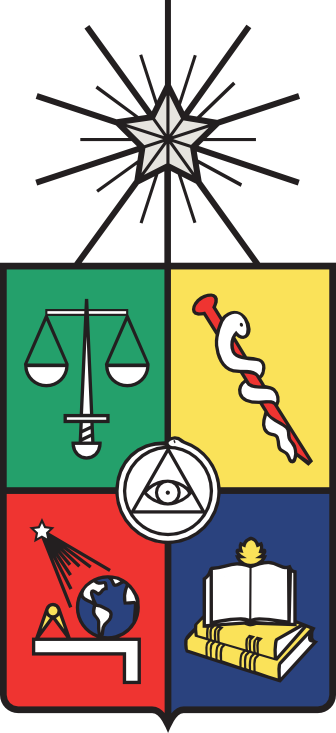

# GSM-TD
 <!-- PROJECT LOGO -->
<br />
<p align="center">
  <a href="https://github.com/cedetec/GMF-TD-CMP">
    
    
    
  </a>

  <h3 align="center"> Software: GMF-TD-CMP </h3>
  <h3 align="center"> A ROBUST MODELING FRAMEWORK TO INVESTIGATE TRANSMISSIBLE DISEASES: A COMPARATIVE STUDY  </h3>
  <p align="center">
    Team: Patricio Cumsille (U. Bío-Bío), Oscar Rojas (U. Santiago de Chile) and Carlos Conca (U. de Chile)
    <br />
    <a href="https://github.com/cedetec/GMF-TD-CMP"><strong>Explore the docs »</strong></a>
    <br />
    <br />
    <a href="https://github.com/cedetec/GMF-TD-CMP/blob/main/main.m">main</a>
  </p>
</p>

<!-- TABLE OF CONTENTS -->
<details open="open">
  <summary><h2 style="display: inline-block">Table of Contents</h2></summary>
  <ol>
    <li>
      <a href="#about-the-project">About The Project</a>
      <ul>
        <li><a href="#run">run</a></li>
      </ul>
    </li>
    <li>
      <a href="#getting-started">Getting Started</a>
      <ul>
        <li><a href="#prerequisites">Prerequisites</a></li>
        <li><a href="#installation">Installation</a></li>
      </ul>
    </li>
    <li><a href="#usage">Usage</a></li>
   <ul>
        <li><a href="#run">main configuration</a></li>
        <li><a href="#data">Official data</a></li>
      </ul>    
    <li><a href="#contributing">Contributing</a></li>
     <li><a href="#Author-contributions">Author contributions</a></li> 
      <li><a href="#license">License</a></li>
 <!--   <li><a href="#contact">Contact</a></li>
    <li><a href="#acknowledgements">Acknowledgements</a></li>-->
  </ol>
</details>


<!-- ABOUT THE PROJECT -->
## About The Project

This repository contains a set of computational techniques and numerical algorithms that allow obtaining epidemiological parameters from SIR models with constant time delays. The underlying method implemented is a general epidemiological model that allows for the evolution of epidemiological parameters, which is useful for public decision-making in the face of health emergencies and other applications derived from the simulation of epidemiological scenarios. COVID-19 data for the entire Chilean territory is used as a case study.

### run 

* open file ./main.m and run with matlab 

<!-- GETTING STARTED -->
## Getting Started

To get a local copy up and running follow these simple steps.

### Prerequisites
matlab 2014 or higher

* https://la.mathworks.com/products/matlab.html 

### Installation

1. Clone the repo
   ```sh
   git clone https://github.com/cedetec/GMF-TD-CMP.git
   ```
2. cd directory
   ```sh 
   cd ./GMF-TD
   ```
<!-- USAGE EXAMPLES -->
## Usage
In root folder, edit "main.m" to run predefined experiments, where 'test_paper_build_tables.m' loads the experimental data and params.
   ```sh
clear
addpath(genpath('./'))
```

### original data -  OFFLINE (on 2025)

Official data from the Chilean Ministry of Science repository, https://github.com/MinCiencia/Datos-COVID19  (down)

## Contributing
<!-- CONTRIBUTING -->

Contributions are what make the open source community such an amazing place to be learn, inspire, and create. Any contributions you make are **greatly appreciated**.
<!-- CONFLICT OF INTEREST STATEMENT -->
The authors declare that the research was conducted without commercial or financial relationships that could constitute a potential conflict of interest.

<!-- LICENSE -->
## License

Distributed under the MIT License. See `LICENSE` for more information.

<!-- CONTACT -->
## Contact

O. Rojas - oscar.rojas.d@usach.cl

Project Link:([https://github.com/cedetec/GMF-TD-CMP](https://github.com/cedetec/GMF-TD-CMP))

## History

This work is an improved extension of the source code presented in [GSM-covid19CL](https://github.com/cedetec/GMF-TD-CMP) of publication "A ROBUST MODELING FRAMEWORK TO INVESTIGATE TRANSMISSIBLE DISEASES: A COMPARATIVE STUDY" <a href="https://doi.org/">https://doi.org/</a>.

## Author contributions
<!-- AUTHOR CONTRIBUTIONS -->

- Collaborative research
  - Department of Basic Sciences, Faculty of Sciences, University of Bío-Bío (P. Cumsille).
  - Department of Mathematics and Computer Science, Faculty of Science, University of Santiago of Chile (O. Rojas).
  - Department of Mathematical Engineering (DIM) and Center for Mathematical Modeling (CMM), University of Chile (C. Conca).
  - Centre for Biotechnology and Bioengineering (CeBiB), University of Chile (C. Conca, P. Cumsille and O. Rojas).
  - Center for Development, Experimentation and Transfer of Educational Technology (CEDETEC),  University of Santiago of Chile (O. Rojas) 

PC contributed to conceptualization, formal analysis, investigation, methodology,  software.
ORD contributed to conceptualization, formal analysis, investigation, methodology, software.
CC contributed to the supervision project.


<!-- ACKNOWLEDGEMENTS -->
## Acknowledgements
Funding 

<!--  The Centre for Biotechnology and Bioengineering (CeBiB), Grant Number ANID AFB240001, partially supported all authors. Finally, the ACE210010 and CMM PIA AFB170001 projects partially supported the third author.
<!-- 
<a rel="license" href="http://creativecommons.org/licenses/by/4.0/"></a><br />This work is licensed under a <a rel="license" href="http://creativecommons.org/licenses/by/4.0/">Creative Commons Attribution 4.0 International License</a>.

